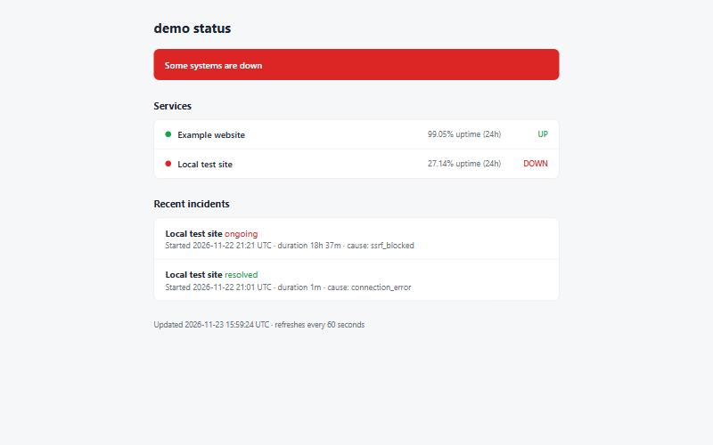
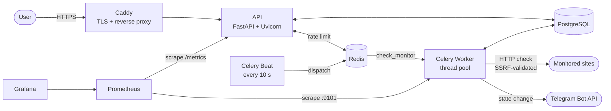
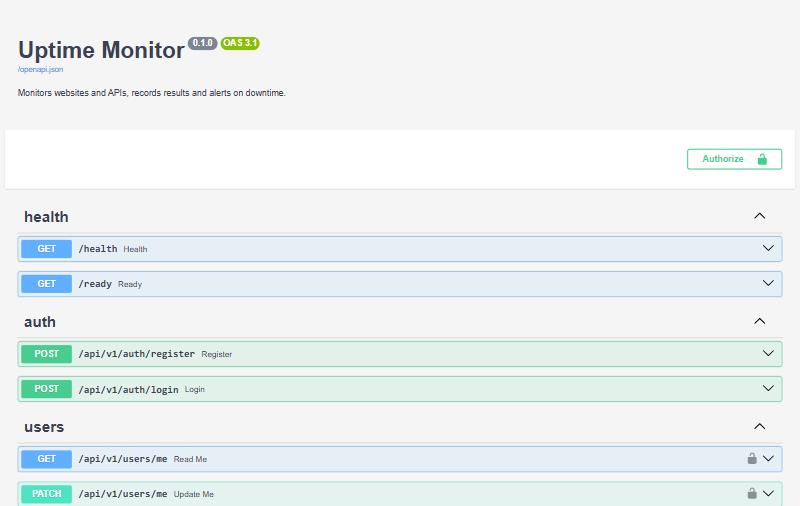
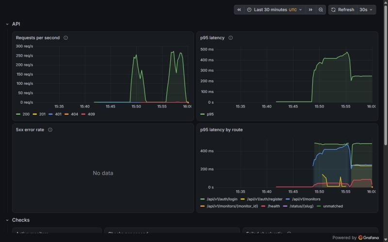

# Uptime Monitor

[](https://github.com/emirkabacali/uptime-monitor/actions/workflows/ci.yml)

**Monitors websites and APIs around the clock, records every check, opens incidents and
sends Telegram alerts when a site goes down and when it recovers.**

A backend + DevOps portfolio project: FastAPI, PostgreSQL, Celery + Redis, Docker,
GitHub Actions CI/CD, Caddy (HTTPS), Prometheus and Grafana.

> **Live demo:** deployment to a VPS is prepared (see [Deployment](#deployment)) and the link
> will be added here once the server is online.



## Architecture



**How a check works:** Beat enqueues `dispatch_due_checks` every 10 seconds. It selects due
monitors with `SELECT ... FOR UPDATE SKIP LOCKED`, moves `next_check_at` forward and enqueues
one `check_monitor` task each, so a monitor is never queued twice. The worker validates the
URL against SSRF rules, sends a GET with a timeout (following at most 5 redirects manually,
validating each hop), stores the result, and runs the state machine under a row lock. After
`FAILURE_THRESHOLD` (3) failures in a row the monitor is DOWN, one incident opens and one
alert is sent; the first success closes the incident and sends a recovery alert with the
downtime.

## Features

- Registration and login with JWT (Argon2 password hashing, login rate limiting)
- Monitor CRUD with pause/resume, per-user limit, pagination; users only see their own data
- Periodic HTTP checks (30 s – 1 h interval, 1–30 s timeout) with error classification:
  `timeout`, `dns_error`, `connection_error`, `ssl_error`, `too_many_redirects`,
  `ssrf_blocked`, `http_<status>`
- UP/DOWN state machine with a failure threshold (no alert flapping) and incidents
- Telegram notifications on state changes only, with retries and exponential backoff
- Statistics per monitor computed in SQL: uptime %, average and **p95** response time,
  incidents and downtime for 24 h / 7 d / 30 d
- Public status page (server-side rendered) showing only monitors marked public
- Health (`/health`) and readiness (`/ready`) endpoints
- JSON logs with request ids, Prometheus metrics, Grafana dashboard provisioned from code

## Tech stack and why

| Area | Choice | Why |
|---|---|---|
| Language / packaging | Python 3.12, **uv** | Fast, reproducible installs from a lock file |
| Web framework | **FastAPI** | Validation with Pydantic, automatic OpenAPI/Swagger, dependency injection |
| Database | **PostgreSQL 17** + SQLAlchemy 2 + Alembic | Partial unique indexes, `FOR UPDATE SKIP LOCKED`, `percentile_cont`; schema changes only through migrations |
| Background jobs | **Celery** + **Redis** | Periodic scheduling (Beat), retries, acks-late; Redis also serves rate limiting ([ADR 0002](docs/decisions/0002-celery-with-redis-for-checks.md)) |
| HTTP client | **httpx** | Timeouts, manual redirect control, streaming (body never read) |
| Auth | **pwdlib (Argon2)**, **PyJWT** | Current FastAPI recommendation; passlib is unmaintained |
| Tests | pytest, respx, real PostgreSQL | Same database engine as production; network fully mocked |
| Containers | Docker multi-stage, Compose | One image, three roles (api, worker, beat) ([ADR 0003](docs/decisions/0003-one-process-per-container.md)) |
| CI/CD | GitHub Actions, GHCR | Lint, tests with service containers, image build; deploy by commit SHA |
| Edge | **Caddy** | Automatic Let's Encrypt certificates with a few lines of config |
| Observability | prometheus-client, Prometheus, Grafana | Pull-based metrics, dashboards as code ([ADR 0004](docs/decisions/0004-prometheus-metrics-in-process.md)) |

## Screenshots

| Swagger UI | Grafana dashboard |
|---|---|
|  |  |

## Quick start (Docker)

Requirements: Docker with Docker Compose.

```bash
cp .env.example .env
sed -i "s|^JWT_SECRET=.*|JWT_SECRET=$(openssl rand -base64 48)|" .env
docker compose up -d --build
```

This starts PostgreSQL, Redis, a one-off migration job, the API, the worker, the scheduler,
Prometheus and Grafana. Application containers run as a non-root user and only the API
(8000) and Grafana (localhost:3000) are published.

- http://localhost:8000/docs — Swagger UI
- http://localhost:8000/health, http://localhost:8000/ready
- http://localhost:3000 — Grafana (`admin` / `GRAFANA_ADMIN_PASSWORD` from `.env`)

`docker compose ps` should show every service as running/healthy and `migrate` as exited (0).

## Using the API

1. `POST /api/v1/auth/register` with `{"email": "...", "password": "..."}` (min. 8 characters).
2. In Swagger, click **Authorize** and log in with your email and password.
3. `POST /api/v1/monitors` with `{"name": "My site", "url": "https://example.com"}`.
4. Watch `GET /api/v1/monitors/{id}/checks`, `/stats?period=24h` and `/incidents`.
5. Publish a status page: `PATCH /api/v1/users/me` with `{"status_slug": "my-company"}`,
   mark monitors `is_public`, open `/status/my-company`.

All errors share one JSON shape: `{"detail": "...", "code": "..."}`.

### Telegram notifications

1. In Telegram, open **@BotFather**, send `/newbot`, and put the token into
   `TELEGRAM_BOT_TOKEN` in `.env`; restart the API and the worker.
2. Send any message to your bot, then open `https://api.telegram.org/bot<TOKEN>/getUpdates`
   and copy `result[0].message.chat.id`.
3. `PATCH /api/v1/users/me` with `{"telegram_chat_id": "<chat id>"}`, then
   `POST /api/v1/users/me/test-notification`.

## Development

Requirements: Python 3.12+, [uv](https://docs.astral.sh/uv/), Docker (for PostgreSQL and Redis).

```bash
uv sync
cp .env.example .env    # set JWT_SECRET as above
docker compose -f docker-compose.yml -f docker-compose.dev.yml up -d postgres redis
uv run alembic upgrade head

uv run uvicorn app.main:app --reload
uv run celery -A app.worker.celery_app worker --pool=threads --concurrency=20 --loglevel=INFO
uv run celery -A app.worker.celery_app beat --loglevel=INFO   # exactly one beat

uv run pytest                 # 240 tests, ~96% coverage
uv run ruff check . --fix && uv run ruff format .
uv run pre-commit install
```

Tests run against a separate PostgreSQL database (`uptime_test`, created automatically);
each test runs in a transaction that is rolled back. The network is mocked with respx and a
fake DNS resolver, so tests never touch the internet.

## Testing and CI

Every push and pull request runs [CI](.github/workflows/ci.yml):

1. **lint** — `ruff check` and `ruff format --check`
2. **test** — PostgreSQL and Redis service containers, `alembic upgrade head`, pytest with
   coverage (fails below 80%; currently ~96%)
3. **build** — Docker image; on `main` it is pushed to GHCR as `latest` and the commit SHA

`main` is protected: changes arrive through pull requests and cannot be merged until all
three jobs pass.

**Load test** ([loadtest/](loadtest/README.md)): k6, 50 virtual users listing monitors. A
profile showed the time was spent on database round trips; merging the count and page
queries into one (window function) and sizing the connection pool raised throughput from
235 to ~265 requests/s and cut p95 latency from 309 ms to ~257 ms on one API process.

## Deployment

Production runs on one Ubuntu VPS with Docker Compose (`deploy/docker-compose.prod.yml`).
Caddy terminates HTTPS with an automatic Let's Encrypt certificate and is the only service with
public ports (80/443); Grafana is served at `grafana.<domain>` behind its login. Every commit
that passes CI on `main` is deployed by [`deploy.yml`](.github/workflows/deploy.yml) over SSH:
pull the image tagged with the commit SHA, run migrations, restart, smoke-test `/health` and
`/ready`. Rollback = deploy an older SHA. Daily `pg_dump` backups keep the last 7 copies and
the restore is tested. Full runbook: [docs/deployment.md](docs/deployment.md).

## Security

- **SSRF protection** ([`url_validator.py`](app/services/url_validator.py)): only http/https,
  no credentials in URLs, and **every** IP the hostname resolves to must be public (loopback,
  private, link-local incl. `169.254.169.254`, multicast, reserved, CGNAT and IPv4-mapped IPv6
  forms are rejected). Checked when a monitor is saved **and** before every request, and
  again for each redirect hop. Response bodies are never read.
- Passwords hashed with Argon2; JWT secret must be ≥ 32 bytes or the app does not start.
- Another user's monitor returns **404**, not 403, so ids do not leak.
- Login rate limit per IP (Redis); containers run as non-root; PostgreSQL, Redis and
  `/metrics` are never exposed publicly; secrets only in `.env` / GitHub Environments.
- Logs never contain request bodies, query strings, passwords or tokens.

## Known limitations

- **DNS rebinding:** the hostname is resolved during validation and again when connecting;
  a malicious DNS server could answer differently the second time. Full protection requires
  connecting to the already-validated IP.
- Checks run from a single location, so a network problem near the server looks like an
  outage everywhere.
- One API process uses one CPU core for Python code; scale out with more containers.
- JWTs cannot be revoked before they expire (60 minutes).
- Prometheus alert rules exist, but no Alertmanager routes them yet.

## Future plans

Alertmanager → Telegram for infrastructure alerts, SSL certificate expiry checks, e-mail
notifications (one more `Notifier` implementation), multi-region workers, Loki for logs,
Kubernetes manifests and Terraform for the server.

## Design decisions

Architecture decision records are in [`docs/decisions/`](docs/decisions/).

## Acknowledgements

Developed with Claude Code as a pair-programming and learning tool. All design decisions
are documented in `docs/decisions/`.

## License

MIT
